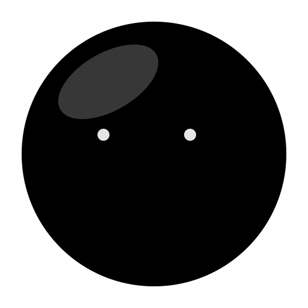

<div align="center">



# Mayli
### The Ultimate Dynamic Notch & Dynamic Island Experience for Windows 10 & 11
**ناچ هوشمند و جزیره پویا برای ویندوز**

[](https://github.com/Mahdilvl20/Mayli/releases)
[](https://github.com/Mahdilvl20/Mayli)
[](https://github.com/Mahdilvl20/Mayli)
[](https://dotnet.microsoft.com/)
[](LICENSE)

<br/>

**[Download Latest Installer (v1.1.64)](https://github.com/Mahdilvl20/Mayli/releases/latest)** • **[Features](#features)** • **[Essential Shortcuts](#-essential-shortcuts--interactions--جدول-شورتکاتها-و-کلیدهای-میانبر-ناچ)** • **[راهنمای فارسی](#-معرفی-مایلی-mayli---ناچ-هوشمند-ویندوز)**

---

</div>

## Overview | نمای کلی

**Mayli** brings the fluid, hardware-integrated aesthetics of the **MacBook Notch** and iPhone **Dynamic Island** straight to your Windows desktop. Designed from the ground up in high-performance C# / WPF on .NET 10, Mayli transforms the unused top bezel of your monitor into an intelligent, animated **Windows Notch** and **Dynamic Island**.

From real-time media player tracking with live audio spectrum visualizers to instant clipboard interactions, hardware HUD notifications, animated keyboard language switching, and split satellite islands—Mayli delivers the most refined **Notch for Windows** experience with zero system bloat and smooth 60/120 FPS hardware-accelerated animations.

---

## Key Highlights & Features

### 🖥️ Dynamic Notch Styles & Shapes
- **Notch Mode:** Seamlessly pinned to the top screen bezel, giving any monitor an authentic, elegant MacBook Pro notch feel.
- **Island Mode:** A floating, detached **Dynamic Island** that hovers gracefully at the top of your display.
- **Line Mode:** A ultra-thin, sleek status bar for minimalist setups.
- **Multiple Shapes & Sizes:** Choose between **Compact**, **Wide**, **Classic**, or **Ultra-Compact** notch profiles with dynamic auto-scaling (60% to 140%).

### 🎵 Live Activities & Media Notch
- **Universal Media Player Integration:** Deep GSMTC integration with Spotify, Apple Music, YouTube Music, Chrome, Edge, Firefox, VLC, and local media players.
- **Adaptive Dominant Color Palette:** The notch organically extracts dominant accent colors directly from album artwork.
- **Audio Spectrum Equalizer:** Real-time animated audio visualizer synced with sound playback.
- **Progress & Scrubbing:** Fluid progress bar with elapsed/remaining duration and instant play/pause/skip transport controls.

### 🌐 Animated Keyboard Language Switcher *(New in v1.1.64)*
- **Real-Time Layout Detection:** Instantly detects input language switches via `Alt + Shift`, `Win + Space`, `Ctrl + Shift`, or Windows taskbar selection.
- **High-Priority Notch Banner:** Language switch banners take first priority, seamlessly displaying language name and ISO badge (`فارسی · FA`, `English · EN`, `Türkçe · TR`, etc.).
- **3D Globe Vector Animation:** Integrated vector spinning globe animation derived from the *AnimateIcons* library.

### 🏝️ Split Satellite Islands
- When media is playing and a notification (or timer) arrives, Mayli dynamically splits into multi-island capsules:
  - **Left Island (Satellite):** Detaches the album artwork with animated beat glow.
  - **Main Capsule:** Expands to show the notification banner or language alert.
  - **Right Island:** Displays active countdown timers or battery charging indicators.

### 📋 Smart Clipboard & File Shelf
- **Animated Copy & Cut Banners:** Smooth vector animations (scissors for Cut, checkmark card for Copy) with live text or image previews.
- **Persistent Drag & Drop File Shelf:** Drag files, images, or snippets directly into the notch for temporary holding and quick sharing across apps.

### 📊 Expandable Dashboard & Widgets
Hover or click the notch to expand into a unified, glassmorphism dashboard:
- **System Monitor:** Real-time CPU, RAM, and Disk utilization gauges.
- **Screen Time:** Daily computer usage and top application tracker.
- **Weather Widget:** Live temperature, condition icons, and forecast.
- **Dual Calendar System:** Fully supports both **Jalali (هجری شمسی)** and **Gregorian** calendars with Persian day/month formatting.
- **Focus & Timers:** Pomodoro, custom countdowns, and stopwatch with detached notch tracking.
- **Quick Notes & Links:** Instant scratchpad and web shortcuts directly from the notch.

### 🎨 Themes & Customization
- **4 Official Aesthetic Themes:** *Pure Black*, *Ember Dark*, *Vivid*, and *Silver (Light Mode)*.
- **Customizable Banner Font Size:** Small, Medium, Large, and Extra Large font options.
- **Full Bilingual Localization:** Seamless switching between **English** and **فارسی (Persian)**.

---

## ⌨️ Essential Shortcuts & Interactions | جدول شورت‌کارت‌ها و کلیدهای میانبر ناچ

Below are the dedicated shortcuts and interaction gestures built into Mayli:

### 1. Global Notch Controls | کلیدهای اصلی کنترل ناچ
| Shortcut | کلید میانبر | Action Description | توضیحات عملکرد |
| :--- | :--- | :--- | :--- |
| <kbd>Ctrl</kbd> + <kbd>Alt</kbd> + <kbd>N</kbd> | <kbd>Ctrl</kbd> + <kbd>Alt</kbd> + <kbd>N</kbd> | **Toggle Notch Dashboard**<br/>*(Works globally, or with your custom shortcut e.g. `Ctrl+Shift+Space`)* | **باز کردن / بستن داشبورد ناچ**<br/>*(شورت‌کات سراسری، یا کلید سفارشی تعیین‌شده در تنظیمات)* |
| <kbd>Ctrl</kbd> + <kbd>Shift</kbd> + <kbd>H</kbd><br/>*Fallback: <kbd>Ctrl</kbd>+<kbd>Alt</kbd>+<kbd>H</kbd>* | <kbd>Ctrl</kbd> + <kbd>Shift</kbd> + <kbd>H</kbd><br/>*جایگزین: <kbd>Ctrl</kbd>+<kbd>Alt</kbd>+<kbd>H</kbd>* | **Tuck / Hide Notch**<br/>*(Smoothly slides and hides notch completely off-screen; press again to restore)* | **مخفی کردن کامل ناچ (Tuck)**<br/>*(ناچ را به نرمی به بالا کشیده و مخفی می‌کند؛ با فشردن مجدد ناچ ظاهر می‌شود)* |
| <kbd>Esc</kbd> | <kbd>Esc</kbd> | **Close Expanded Notch**<br/>*(Instantly collapses open dashboard back to compact notch)* | **بستن فوری داشبورد ناچ**<br/>*(داشبورد باز شده را بلافاصله جمع کرده و به ناچ فشرده بازمی‌گرداند)* |

### 2. Fast Tool Navigation | جابجایی مستقیم بین ابزارهای ناچ *(هنگام باز بودن داشبورد)*
| Shortcut | کلید میانبر | Tool / Dashboard Tab | ابزار مقصد در ناچ |
| :--- | :--- | :--- | :--- |
| <kbd>Alt</kbd> + <kbd>1</kbd> | <kbd>Alt</kbd> + <kbd>1</kbd> | **Home** (Central Dashboard & Active Widgets) | **صفحه اصلی** (ابزارک‌ها و کارت‌های برتر) |
| <kbd>Alt</kbd> + <kbd>2</kbd> | <kbd>Alt</kbd> + <kbd>2</kbd> | **System** (CPU, RAM & Disk Monitor) | **مانیتور سیستم** (پردازنده، حافظه و هارد) |
| <kbd>Alt</kbd> + <kbd>3</kbd> | <kbd>Alt</kbd> + <kbd>3</kbd> | **Clipboard** (History Cards & Search) | **تاریخچه کلیپ‌بورد** (کپی‌ها و عکس‌ها) |
| <kbd>Alt</kbd> + <kbd>4</kbd> | <kbd>Alt</kbd> + <kbd>4</kbd> | **Notes** (Quick Scratchpad) | **یادداشت‌ها** (یادداشت سریع و ذخیره آنی) |
| <kbd>Alt</kbd> + <kbd>5</kbd> | <kbd>Alt</kbd> + <kbd>5</kbd> | **Focus & Timer** (Pomodoro & Countdown) | **تایمر و تمرکز** (پومودورو، آلارم و کرنومتر) |
| <kbd>Alt</kbd> + <kbd>6</kbd> | <kbd>Alt</kbd> + <kbd>6</kbd> | **File Shelf** (Temporary Drag & Drop Storage) | **قفسه فایل** (نگهداری موقت و انتقال فایل) |
| <kbd>Alt</kbd> + <kbd>7</kbd> | <kbd>Alt</kbd> + <kbd>7</kbd> | **Weather** (Live Forecast & Metrics) | **آب و هوا** (دما، سرعت باد و پیش‌بینی) |
| <kbd>Alt</kbd> + <kbd>8</kbd> | <kbd>Alt</kbd> + <kbd>8</kbd> | **Clock** (World Clock & Stopwatch) | **ساعت** (ساعت جهانی و زمان‌سنج) |
| <kbd>Alt</kbd> + <kbd>9</kbd> / <kbd>Alt</kbd> + <kbd>C</kbd> | <kbd>Alt</kbd> + <kbd>9</kbd> / <kbd>Alt</kbd> + <kbd>C</kbd> | **Calendar** (Jalali شمسی & Gregorian) | **تقویم** (تقویم هجری شمسی و میلادی) |
| <kbd>Alt</kbd> + <kbd>0</kbd> / <kbd>Alt</kbd> + <kbd>U</kbd> | <kbd>Alt</kbd> + <kbd>0</kbd> / <kbd>Alt</kbd> + <kbd>U</kbd> | **Units Converter** (Currencies & Measures) | **تبدیل واحدها** (واحدهای اندازه‌گیری و ارز) |
| <kbd>Alt</kbd> + <kbd>L</kbd> | <kbd>Alt</kbd> + <kbd>L</kbd> | **Quick Links** (Favorite Web Bookmarks) | **لینک‌های سریع** (دسترسی به سایت‌های منتخب) |
| <kbd>Alt</kbd> + <kbd>M</kbd> | <kbd>Alt</kbd> + <kbd>M</kbd> | **Messages** (AI Companion Chat & Notes) | **پیام‌ها** (یادآورها و تعامل با همراه) |
| <kbd>Alt</kbd> + <kbd>S</kbd> | <kbd>Alt</kbd> + <kbd>S</kbd> | **Screen Time** (Daily App Usage Stats) | **زمان مصرف صفحه** (نمودار مصرف برنامه‌ها) |

### 3. Mouse Gestures & Interactions | روش‌های تعامل با نشانگر موس روی ناچ
| Action | تعامل موس | Effect | نتیجه تعامل |
| :--- | :--- | :--- | :--- |
| **Hover on Notch** | **نگه داشتن موس روی ناچ** | Quick peek at digital clock, now playing track, or running timer without expanding. | پیش‌نمایش سریع ساعت، موزیک در حال پخش یا زمان باقیمانده بدون نیاز به کلیک |
| **Click on Notch** | **کلیک چپ روی ناچ** | Expands the notch into the full glassmorphic dashboard. | باز کردن ناچ به داشبورد کامل شیشه‌ای ابزارها |
| **Right-Click on Notch** | **کلیک راست روی ناچ** | Opens Notch quick settings and customization panel. | باز کردن سریع پنل تنظیمات ناچ و شخصی‌سازی |
| **Drag & Drop to Notch** | **کشیدن و رها کردن فایل روی ناچ** | Instantly drops files, photos, or documents into the temporary Notch File Shelf. | ذخیره آنی فایل‌ها و عکس‌ها در قفسه ناچ جهت انتقال سریع |
| **Click System Tray Icon** | **کلیک روی آیکون ترای (سینی ویندوز)** | Toggles notch dashboard and allows choosing Mayli companion moods. | باز/بسته کردن ناچ و تغییر حالات حیوان خانگی همراه مایلی |
| **Notch Media Controls** | **دکمه‌های مالتی‌مدیا روی ناچ** | Click play, pause, next track, or previous track directly inside the notch. | کنترل مستقیم پخش موزیک (پخش، توقف، بعدی، قبلی) از داخل ناچ |

---

## 📥 Installation

### Method 1: Windows Setup Installer (Recommended)
1. Download the latest installer **[Mayli_Setup_v1.1.64.exe](https://github.com/Mahdilvl20/Mayli/releases/latest)** from GitHub Releases.
2. Run the installer and follow the quick setup wizard.
3. Mayli will launch automatically and anchor to the top of your screen.

### Method 2: Build From Source
```powershell
# Clone the repository
git clone https://github.com/Mahdilvl20/Mayli.git
cd Mayli

# Build in Release mode
dotnet build src/Mayli/Mayli.csproj -c Release

# Run Mayli
./src/Mayli/bin/Release/net10.0-windows10.0.19041.0/Mayli.exe
```

---

<div dir="rtl" align="right">

## 🇮🇷 معرفی مایلی (Mayli) - ناچ هوشمند ویندوز

**مایلی (Mayli)** نرم‌افزاری مدرن، فوق‌العاده سریع و سبک است که تجربه جذاب و کاربردی **ناچ مک‌بوک (MacBook Notch)** و **داینامیک آیلند (Dynamic Island)** را با بالاترین کیفیت بصری به ویندوز ۱۰ و ۱۱ می‌آورد. این برنامه بدون افت فریم و با استفاده حداقلی از منابع سیستم، لبه بالایی مانیتور شما را به یک مرکز کنترل هوشمند و زنده تبدیل می‌کند.

### قابلیت‌های برجسته مایلی:
1. **استایل‌های متنوع ناچ:** امکان انتخاب میان حالت **ناچ متصل به لبه (Notch)**، **جزیره شناور (Dynamic Island)** و **خط مینیمال (Line)** با سایزهای کامپکت، عریض و کلاسیک.
2. **پخش زنده رسانه و آهنگ (Now Playing):** پشتیبانی از اسپاتیفای، اپل موزیک، یوتیوب، ساندکلاد و تمام مرورگرها همراه با اکولایزر زنده، استخراج رنگ کاور آرت و دکمه‌های کنترل آهنگ.
3. **انیمیشن تغییر زبان کیبورد (جدید در نسخه ۱.۱.۶۴):** نمایش بنر انیمیشنی کره زمین با اولویت بالا هنگام فشردن `Alt + Shift` یا `Win + Space` با تشخیص آنی و نمایش عنوان زبان (`فارسی · FA` و `English · EN`).
4. **جزیره‌های ماهواره‌ای جداشونده (Split Satellite Islands):** هنگام پخش آهنگ و ورود اعلان یا تایمر، کاور آهنگ به صورت خودکار به جزیره سمت چپ و ارقام تایمر به جزیره سمت راست منتقل می‌شوند.
5. **بنر کپی و کات اختصاصی:** انیمیشن‌های روان وکتوری برای کپی و کات متن، تصویر و فایل‌ها با امکان تنظیم سایز فونت بنر در تنظیمات.
6. **مخفی‌سازی آنی ناچ با شورت‌کات `Ctrl + Shift + H`:** هر زمان که نیاز داشته باشید، می‌توانید ناچ را به طور کامل مخفی کنید تا تمام فضای بالای صفحه آزاد شود و با فشردن مجدد آن را بازگردانید.
7. **داشبورد ابزارها:** دسترسی آسان با کلیک یا کلید میانبر `Ctrl + Alt + N` به مانیتور سیستم (CPU/RAM/Disk)، زمان مصرف صفحه (Screen Time)، وضعیت آب و هوا، تایمر و پومودورو، تقویم دوزبانه شمسی و میلادی، یادداشت‌ها و قفسه فایل موقت.
8. **پشتیبانی کامل از زبان فارسی:** رابط کاربری کاملاً دوزبانه (فارسی و انگلیسی) همراه با تقویم هجری شمسی و تم‌های دارک و لایت.

---

</div>

## Tech Stack & Architecture

- **Language & Runtime:** C# 13, .NET 10 (`net10.0-windows10.0.19041.0`)
- **UI Framework:** Windows Presentation Foundation (WPF) with pure hardware-accelerated Direct3D composition
- **Windows APIs & Hooks:** Win32 Low-Level Keyboard Hooks (`WH_KEYBOARD_LL`), WinEvent hooks, GSMTC (`Windows.Media.Control`), CoreAudio WASAPI, WMI brightness & monitor DDC/CI
- **Packaging:** Inno Setup 6 (Ultra LZMA2 compressed standalone installer)

---

## License

This project is licensed under the [MIT License](LICENSE).

<div align="center">

Crafted with care by **[Mahdi](https://github.com/Mahdilvl20)** & Modi Studio.  
*Give a ⭐ on GitHub if you love having a Dynamic Notch on Windows!*

</div>
